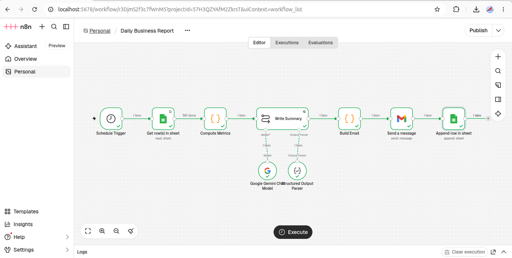

# Daily Business Report Automation (n8n)

I built this workflow to replace the morning routine of opening spreadsheets and working out how yesterday went.

## What it does

Every morning n8n reads the orders from a Google Sheet and works out revenue, order count, average order value, refund rate, top products and category totals. It compares the day with the day before and with the 7-day average. Gemini then writes a short summary of what stands out and what's worth checking, and the report arrives as an HTML email. Each run is also logged to a history sheet.

The numbers are calculated in code, not by the AI. The AI only sees the finished figures and is told not to invent reasons, so it can describe what happened without making things up.

## Features

- Metrics are calculated in a Python Code node, with no external libraries.
- The AI summary only uses the numbers it's given, and any possible cause is labelled as something to check.
- Mobile-friendly HTML email, with the revenue change shown in red or green.
- Every report is logged to a Report History sheet.
- If something breaks, a separate workflow emails me the error. The AI step retries on its own first.

## Stack

n8n (self-hosted in Docker), Gemini API, Gmail, Google Sheets, Python and JavaScript Code nodes.

## Run it

Import `daily-report.json` and `error-alert.json` into n8n and add your Gemini, Gmail and Sheets credentials.

Create a Google Sheet with two tabs:

- **Orders:** order_id, order_date, customer, product, category, quantity, unit_price, total, status
- **Report History:** report_date, revenue, orders, avg_order_value, refund_rate, revenue_change_vs_prior_day, top_product, sent_at

`sample-data/orders.csv` has 60 days of made-up orders you can import into the Orders tab. The report covers the most recent date in that tab. The schedule is set to run daily at 08:00, or click Execute workflow to run it straight away.

The store data is fictional.

Need something like this? Message me on Upwork: [iawaiscode](https://upwork.com/iawaiscode)
