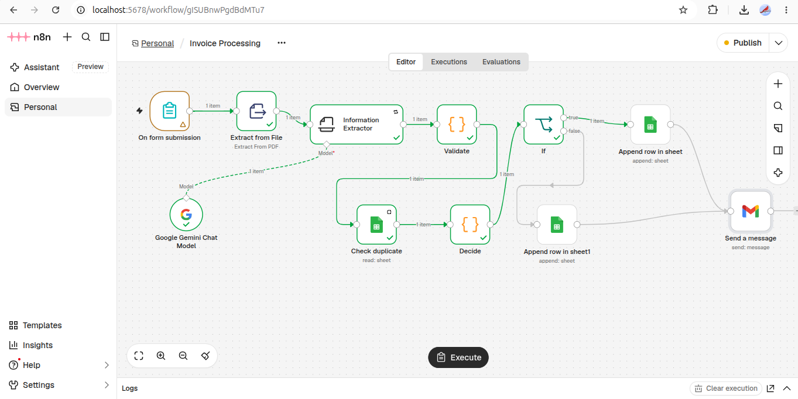

# Invoice Processing Automation (n8n)

I built this workflow to turn PDF invoices into clean spreadsheet rows, and to catch the ones that look wrong before they get recorded.

## What it does

You upload an invoice PDF through a simple form. The text is extracted, and Gemini pulls out the vendor, invoice number, dates, line items, tax and total as structured data. A validation step then checks the numbers and looks for duplicates. Clean invoices go into an Invoices sheet. Anything suspicious goes into a Needs Review sheet and I get an email explaining why.

The AI only reads the invoice. It never fixes or calculates numbers, so a wrong total on the page gets flagged instead of being quietly corrected.

## Features

- Works across different invoice layouts, not one fixed template.
- Checks required fields, that line items add up to the subtotal, that subtotal plus tax matches the total, and that dates make sense.
- Detects duplicates by vendor and invoice number.
- Flagged invoices include a plain-English reason, like "subtotal + tax = 363 but total is 500".
- If a run fails, a separate workflow emails me the error. The AI step retries on its own first.

## Stack

n8n (self-hosted in Docker), Gemini API, Gmail, Google Sheets.

## Run it

Import `invoice-processing.json` and `error-alert.json` into n8n and add your Gemini, Gmail and Sheets credentials.

Create a Google Sheet with two tabs:

- **Invoices:** processed_at, vendor, invoice_number, invoice_date, due_date, currency, subtotal, tax, total, line_items, source_file
- **Needs Review:** the same columns plus reason

Open the form URL from the Form Trigger and upload the files from `sample-invoices/`:

1. `01-clean-acme-INV-1001.pdf` goes to Invoices.
2. Upload it again and it's flagged as a duplicate.
3. `02-different-layout-brightline-2045.pdf` has a different layout and still parses.
4. `03-wrong-total-swift-3310.pdf` has a wrong total and gets flagged.

The invoices are fictional and made up for testing.

Need something like this? Message me on Upwork: [iawaiscode](https://upwork.com/iawaiscode)
