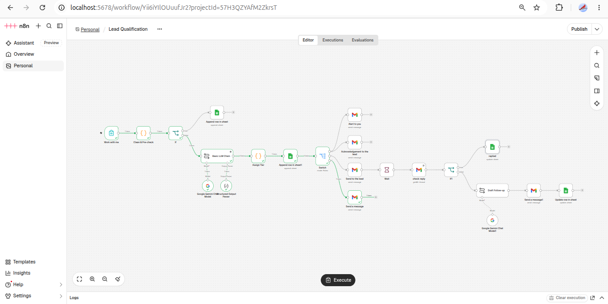

# Lead Qualification Automation (n8n)

I built this workflow to handle inbound enquiries for a freelance service business: filter the junk, score the real leads, and make sure the good ones never wait.

## What it does

Someone fills in a contact form. Obvious spam is caught by rules and logged separately, so it never costs an AI call. Real enquiries get scored from 0 to 100 by Gemini against a rubric covering budget, urgency, clarity and fit with my services. The score decides what happens next:

- **Hot (70+):** I get an instant email with a summary, the key details and a suggested way to reply. The lead gets an acknowledgement.
- **Warm (40 to 69):** The lead gets an acknowledgement. After two days, the workflow checks my sent mail. If I haven't replied, it drafts and sends a short personalised follow-up.
- **Cold (under 40):** A polite automatic reply, and no alert.

Every lead lands in a Google Sheet with its score, tier and status, so it works as a simple CRM.

## Features

- Spam rules run before the AI, so junk is filtered cheaply.
- The AI only returns a score and a summary. The hot, warm and cold thresholds live in code, so they can be tuned without touching the prompt.
- The follow-up is skipped if I've already replied to the lead.
- Each lead's status (new, followed up, replied) is tracked in the sheet.
- If something breaks, a separate workflow emails me the error. The AI steps retry on their own first.

## Stack

n8n (self-hosted in Docker), Gemini API, Gmail, Google Sheets.

## Run it

Import `lead-qualification.json` and `error-alert.json` into n8n and add your Gemini, Gmail and Sheets credentials.

Create a Google Sheet with two tabs:

- **Leads:** received_at, name, email, company, website, service, budget, timeline, message, score, tier, summary, red_flags, status, followup_sent
- **Spam:** received_at, name, email, message, flags

Replace the email addresses in the alert and reply nodes with your own, publish the workflow, and open the form URL from the Form Trigger. For a quick test, set the Wait node to a couple of minutes.

Try these messages:

| Lead | Message |
|---|---|
| Hot | "We get about 200 support tickets a week on Shopify and want a chatbot that answers order and return questions. Need it live within a month." |
| Warm | "Thinking about automating our invoice emails, not sure where to start." |
| Cold | "Just curious what AI can do for a business." |
| Spam | "Best SEO services and backlinks, visit www.a.com and www.b.com" |

The leads and companies are fictional.

Need something like this? Message me on Upwork: [iawaiscode](https://upwork.com/iawaiscode)
