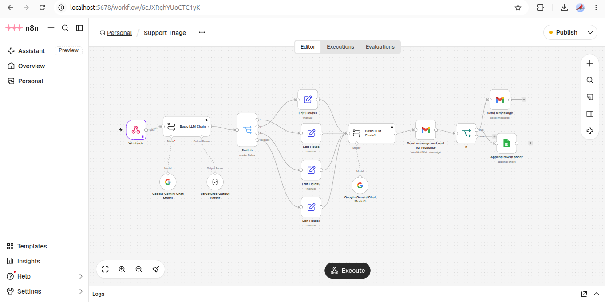

# Support Triage Automation (n8n)

I built wokflow for support emails for a small online store without letting AI talk to customers unchecked.



## What it does

A support message comes in, Gemini figures out what it's about (refund, shipping, product question) and how urgent it is, then writes a reply based on the store's policy for that topic. The draft lands in my inbox with Approve and Disapprove buttons. Only approved replies get sent to the customer. Everything gets logged to a Google Sheet.

I kept a human in the loop on purpose. The AI does the sorting and drafting, but I didn't want it making refunds on its own.

## Features

- The classifier returns structured JSON, so routing doesn't depend on guessing at free text.
- The reply step only sees the relevant policy, so it can't make things up.
- If something breaks, a separate workflow emails me the error. The AI steps retry on their own first.

## Stack

n8n (self-hosted in Docker), Gemini API, Gmail, Google Sheets.

## Run it

Import `support-triage.json` and `error-alert.json` into n8n, add your Gemini, Gmail and Sheets credentials, and point the Sheets node at a sheet with these columns: timestamp, customer, email, category, urgency, sentiment, order_id, summary, reply, status.

Then:

```bash
curl -X POST http://localhost:5678/webhook/support-ticket \
  -H "Content-Type: application/json" \
  -d '{"customer_name":"Ayesha","email":"you@example.com","message":"My order #1042 arrived broken and I want a refund."}'
```

Need something like this? Message me on Upwork: [iawaiscode](https://upwork.com/iawaiscode)
